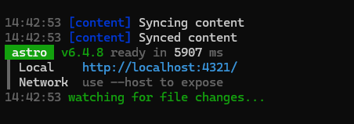

# Tau'ri Dev docs
[https://docs.justsgmod.eu](https://docs.justsgmod.eu)

## Contribution
Create a fork then `git clone` the fork.
You can use IDE of your choise, but we prefer [VS Code](https://code.visualstudio.com/).

You will need to install [Node.js](https://nodejs.org/en).
### Windows
Open the project in the VS Code and to set up the project on your machine run the `setup.bat`.

When the installation of every package is done, run `run-dev.bat` to start the local-hosted server.

Should have this output:

If you change any file, the server will automatically update and rebuild the whole project.

If error occur, you can close the terminal to close the session and run `run-dev.bat` again.

### Linux
Open the project in the VS Code and to set up the project on your machine run
`npm install` inside the project directory.

When the installation of every package is done, run `npm run dev` to start the local-hosted server.

Should have this output:

If you change any file, the server will automatically update and rebuild the whole project.

If error occur, you can press `Ctrl+C` in the terminal to close the session and run `npm run dev` again.